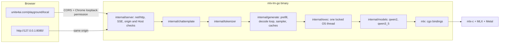
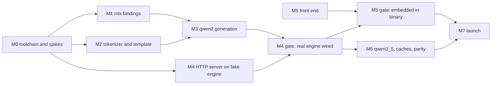

# mlx-lm-go master plan

> **For agentic workers:** this is the master plan. It fixes scope, architecture, interfaces, milestone order and exit gates. Each milestone gets its own bite-sized TDD plan (superpowers:writing-plans) written when the milestone before it passes its gate, then executed with superpowers:subagent-driven-development. Do not start a milestone from this document alone.

**Goal:** an open-source, native Go replacement for `mlx_lm.server` on Apple silicon, with a chat front end that is hosted on unite4ai.com and also embedded in the binary.

**Architecture:** one Go binary links MLX through `mlx-c` with cgo. All MLX calls run on a single OS-thread-locked goroutine; HTTP handlers talk to it over a channel. Tokenizer, chat template, sampler, model code and the OpenAI-compatible HTTP layer are pure Go. The chat UI is a framework-free TypeScript package in the unite4ai repo; the same build is published to unite4ai.com and vendored into the Go binary.

**Tech stack:** Go 1.27, cgo, Homebrew mlx-c 0.8.0 (MLX 0.32.4), `dlclark/regexp2`, `NikolaLohinski/gonja`, `golang.org/x/text`; Bun 1.4, TypeScript, Astro 7 (existing unite4ai toolchain); Python `mlx-lm` only as a test oracle.

**Task-level plans:** `2026-11-21-m0-toolchain.md` (done), `-m1-mlx-bindings.md`, `-m2-tokenizer.md`, `-m2-chat-template.md`, `-m4-http-server.md` in this directory, and `docs/superpowers/plans/2026-11-21-local-chat.md` in the unite4ai repo. Where a task-level plan differs from this document, the task-level plan wins.

---

## 1. Decisions

Chosen by the owner on 2026-11-21:

| Decision | Choice |
|---|---|
| Inference engine | Native Go with our own thin cgo bindings over mlx-c. Not built on Ollama's packages, not a wrapper around Python. |
| Front end | Hosted page on unite4ai.com **and** the same build embedded in the binary from the first release. |
| Name | `mlx-lm-go` (repo, Go module, binary). |

Chosen by the planner; change them here if you disagree:

| Decision | Choice | Reason |
|---|---|---|
| Repo and licence | `github.com/bigshort2022/mlx-lm-go`, MIT | Matches MLX, mlx-c and the unite4ai repo. |
| Platform for 1.0 | macOS on Apple silicon only | MLX's CUDA backend exists but doubles the test matrix. |
| First architecture | `qwen2` (`mlx-community/Qwen2.5-1.5B-Instruct-4bit`, 840 MB, already in the local HF cache) | Plain transformer, 221 lines in mlx-lm. Fast to load, so fast to test. |
| Second architecture | `qwen3_5` (`Qwen3.5-9B-MLX-4bit`, then `Qwen3.8-27B-4bit`) | What mlx-fleet's planner and coder slots run. Hybrid: gated-delta linear attention with full attention every 4th layer. |
| Bindings | Hand-written for the roughly 40 mlx-c functions we need | mlx-c exposes 267 ops; a generator is not justified yet. |
| Array lifetime | Explicit scopes that free every array created inside them unless kept. No finalizers. | Finalizers run late and let GPU memory grow without bound. |
| Model files | Read a local directory or an existing Hugging Face cache snapshot. No downloader in 1.0; a missing model prints the `hf download` command. | Keeps the network out of the server. |
| CORS default | Same-origin only. The hosted page needs `--allowed-origins https://unite4ai.com`. | `mlx_lm.server` defaults to `*`; a public page reaching a local model should be an explicit opt-in. |
| UI source of truth | `packages/local-chat` in the unite4ai repo. mlx-lm-go commits a pinned, checksummed copy of the build. | "Front end at unite4ai", and the Go build must not need Bun. |
| UI protocol | Plain OpenAI-compatible endpoints only (`/v1/models`, `/v1/chat/completions`). No custom routes. | The page then also works against Python `mlx_lm.server`, Ollama and llama.cpp, and can be built before the Go engine exists. |

## 2. Why this project, given Ollama exists

Ollama (MIT) already ships a Go cgo binding for mlx-c and an `mlxrunner` with about 30 architectures. This project does not compete on breadth. Its reasons to exist:

1. **Drop-in for `mlx_lm.server`:** same flags, same endpoints, same response shapes, loading `mlx-community` snapshot directories as they are. mlx-fleet can swap a slot without other changes.
2. **Small and teachable:** one architecture per directory, with mlx-lm's Python as the reference. It becomes course material for the Unite4AI school.
3. **Safe to reach from a browser:** origin allowlist, Host validation and JSON-only POSTs by default.
4. **Parity is proven, not claimed:** golden fixtures from mlx-lm are committed and checked in tests.

`tamnd/fastmlx` attempted a Go MLX server in June 2026 and stopped before its MLX backend; it is a reference for the serving layer only.

## 3. Evidence gathered on 2026-11-21

| Fact | Source |
|---|---|
| mlx-c is at 0.8.0, pinned to MLX v0.32.4 | `~/sandbox/mlx-c/CMakeLists.txt` |
| mlx-c has `MLX_C_USE_SYSTEM_MLX`; Homebrew has `mlx 0.32.4` with `libmlx.dylib` and `mlx.metallib` | CMakeLists, `/opt/homebrew/opt/mlx/lib` |
| Needed C entry points exist: `mlx_load_safetensors`, `mlx_quantized_matmul`, `mlx_dequantize`, `mlx_fast_rms_norm`, `mlx_fast_rope`, `mlx_fast_scaled_dot_product_attention`, `mlx_async_eval`, memory limits, error handler | `mlx-c/mlx/c/*.h` |
| Go is not installed; cmake 4.3.2 is. Homebrew's Go is 1.27.4 | `brew` |
| `mlx_lm.server` 0.31.3 serves `POST /v1/chat/completions`, `POST /v1/completions`, `GET /v1/models`, `GET /health`, `OPTIONS` | `mlx_lm/server.py` in the mlx-fleet venv |
| Both Qwen tokenizers are BPE with NFC normalisation and a split regex containing the lookahead `\s+(?!\S)` | local `tokenizer.json` files |
| Qwen2.5 chat template uses `loop.*`, `tojson`, `is defined`. Qwen3.5's also uses `macro`, `namespace`, `raise_exception`, `loop.previtem`, `loop.nextitem`, `is mapping` | local template files |
| unite4ai.com is a static Astro site; CSP is a meta tag in `apps/web/src/layouts/Base.astro` with `connect-src 'self' https://api.github.com` | unite4ai.github.io repo |
| The existing `/playground` page links out and states "we never proxy inference" | `apps/web/src/pages/playground/index.astro` |
| Chrome gates public-to-loopback requests behind a `loopback-network` permission prompt and needs `targetAddressSpace: 'loopback'` on `fetch` | Chrome developer docs |
| mlx-fleet can attach an already-running server with `pre_existing = true` | `mlx/fleet.compat.toml` |

Not verified, and resolved by a named task below:

- Whether Safari and Firefox on macOS allow an HTTPS page to call `http://127.0.0.1` (WebKit bug 281149 is open). Resolved in M5.
- Whether gonja renders the Qwen3.5 template byte-for-byte like Jinja2. Resolved in M2.
- Where the binary must keep `mlx.metallib`. Resolved in M0: nowhere, with dynamic linking.
- Whether GitHub-hosted macOS runners can run Metal. Resolved in M7; until then GPU tests run locally.

## 4. Architecture



### Package responsibilities

| Package | Does | Depends on |
|---|---|---|
| `mlx` | The only package that imports `"C"`. Arrays, ops, fast ops, safetensors I/O, memory, streams, scopes, error conversion. | mlx-c |
| `internal/exec` | Runs submitted functions on one goroutine pinned with `runtime.LockOSThread`. | none |
| `internal/tokenizer` | Loads `tokenizer.json`; encode, decode, and a streaming detokenizer that holds back incomplete UTF-8. | regexp2, x/text |
| `internal/chattemplate` | Renders `chat_template` with messages, tools and template kwargs. | gonja |
| `internal/hub` | Resolves `--model` to a directory (local path or HF cache snapshot). | none |
| `internal/nn` | Linear, QuantizedLinear, Embedding, QuantizedEmbedding, RMSNorm, RoPE, attention. | `mlx` |
| `internal/models` | Registry keyed by `model_type`; one subpackage per architecture. | `internal/nn` |
| `internal/cache` | KV cache; later gated-delta state cache and prompt-prefix cache. | `mlx` |
| `internal/sample` | Temperature, top-k, top-p, min-p, repetition, presence and frequency penalties, logit bias. | `mlx` |
| `internal/generate` | Stepped prefill and the decode loop. Implements `engine.Engine`. | models, cache, sample, exec |
| `internal/engine` | The `Engine` interface and a deterministic fake. | none |
| `internal/server` | Flags, routes, SSE, cancellation, security middleware. | engine, tokenizer, chattemplate |
| `internal/webui` | `go:embed` of the vendored UI build. | none |
| `cmd/mlx-lm-go` | Subcommands `server`, `generate`, `version`. | all |

### The one interface that lets work run in parallel

```go
package engine

// Engine generates tokens for one request at a time.
type Engine interface {
	// Generate runs until the model emits an end-of-sequence token, MaxTokens
	// tokens have been emitted, or ctx is cancelled. emit is called once per
	// generated token and must not block for long.
	Generate(ctx context.Context, req Request, emit func(token int32)) (Result, error)
}

type Request struct {
	Prompt    []int32 // token ids, already templated and encoded
	MaxTokens int
	Sampling  Sampling // temperature, top-k, top-p, min-p, penalties, logit bias, seed
}

type Result struct {
	PromptTokens     int
	CompletionTokens int
	CachedTokens     int
	FinishReason     string // "stop" or "length"
}
```

Stop strings, reasoning and tool-call parsing work on decoded text and live in `internal/server`, as they do in `mlx_lm/server.py`.

### Rules that hold everywhere

- Every MLX call happens inside `exec`. No other goroutine touches an `mlx.Array`.
- A request the server cannot honour fails loudly. Unsupported flags exit non-zero at startup; unsupported request fields return HTTP 400 naming the field. Nothing is silently ignored.
- A client disconnect cancels the request context and stops decoding within one token.
- Tests that need weights find them through `MLX_LM_GO_TEST_MODEL` or the HF cache and skip when absent. Weights are never committed.

## 5. Compatibility targets

Flags of `mlx_lm.server`:

| Milestone | Flags |
|---|---|
| M4 | `--model --host --port --allowed-origins --log-level --chat-template --chat-template-args --temp --top-p --top-k --min-p --max-tokens --prefill-step-size` |
| M6 | `--prompt-cache-size --prompt-cache-bytes` |
| Rejected with an explicit error in 1.0 | `--adapter-path --draft-model --num-draft-tokens --trust-remote-code --use-default-chat-template --decode-concurrency --prompt-concurrency --pipeline` |

Request fields:

| Milestone | Fields |
|---|---|
| M4 | `messages model max_tokens stream temperature top_p top_k min_p stop repetition_penalty repetition_context_size presence_penalty presence_context_size frequency_penalty frequency_context_size logit_bias chat_template_kwargs` |
| M6 | `logprobs tools` (tool-call parsing), reasoning content split |
| HTTP 400 in 1.0 | `adapters draft_model num_draft_tokens role_mapping` |

Performance gate for M6, measured on the same machine and model against Python `mlx_lm.server`: decode tokens per second and time to first token each within 10%. The forward pass uses the same Metal kernels, so a larger gap means a bug in our graph or cache handling.

## 6. Security model for a server that browsers can reach

1. Bind `127.0.0.1` by default. A non-loopback `--host` logs a warning at startup.
2. Reject any request whose `Host` header is not the bound loopback address and port. This blocks DNS rebinding.
3. Reject any request with an `Origin` header that is not same-origin or in `--allowed-origins`, before parsing the body. CORS headers alone do not stop the request from running.
4. `POST` requires `Content-Type: application/json`, so cross-site forms cannot trigger generation without a preflight.
5. Echo only the matched origin in `Access-Control-Allow-Origin`, with `Vary: Origin`. Never send credentials headers.
6. The embedded UI is served with `Content-Security-Policy: default-src 'self'; base-uri 'none'; form-action 'none'`. It loads no fonts or scripts from the network.
7. The hosted page accepts only loopback server URLs (`127.0.0.1`, `localhost`, `[::1]`) and keeps conversations in memory only.

## 7. Milestones



M5 starts on day one against the Python `mlx_lm.server` already used by mlx-fleet. M2 and the fake-engine part of M4 do not need MLX and can run beside M1.

Sizes are the planner's judgement of relative effort, not estimates.

### M0. Toolchain and risk spikes (small, done)

See `2026-11-21-m0-toolchain.md` for what was done and found. mlx-c comes from Homebrew (`brew install mlx-c`) instead of a submodule. The template and split-regex spikes became the first tasks of M2, backed by golden fixtures.

### M1. `mlx` bindings (medium)

Files: `mlx/{cgo,error,scope,stream,array,ops,fast,io,memory}.go` with a `_test.go` each; `internal/exec/exec.go`.

- [ ] `error.go`: install `mlx_set_error_handler` once; every wrapper returns a Go `error` carrying the MLX message.
- [ ] `scope.go`: `mlx.Scope(func(s *Scope) error)`, `s.Keep(a)`. Test: active memory after 1,000 scoped allocations returns to the baseline reported by `mlx_get_active_memory`.
- [ ] `array.go`: construct from Go slices; read scalars and slices; shape and dtype; `Eval` and `AsyncEval`.
- [ ] `ops.go`: only what `qwen2` needs: add, multiply, matmul, reshape, transpose, concatenate, slice, take, argmax, softmax, logsumexp, where, astype, `quantized_matmul`, `dequantize`, topk, sort, cumsum, categorical sampling.
- [ ] `fast.go`: `rms_norm`, `rope`, `scaled_dot_product_attention`.
- [ ] `io.go`: `LoadSafetensors(path) (map[string]*Array, map[string]string, error)`.
- [ ] `memory.go`: active, peak and cache memory; cache, memory and wired limits; clear cache.
- [ ] `internal/exec`: `Do(ctx, fn) error` on the locked thread. Test: 100 concurrent callers run strictly one at a time and all return.

Exit gate: `go test -race ./mlx/... ./internal/exec/...` passes. Each wrapper has a test comparing against a value computed by NumPy and stored in the test.

### M2. Tokenizer and chat template (medium, no MLX)

Files: `internal/tokenizer/{load,bpe,pretokenize,added,decode,stream}.go`, `internal/chattemplate/{render,helpers}.go`, `tools/oracle/make_fixtures.py`, `testdata/{qwen2,qwen3_5}/{tokenize,template}.jsonl`.

- [ ] Oracle script pinned to `mlx-lm==0.31.3` writes fixtures: 500 strings to token ids, and the M0 conversations to rendered prompts.
- [ ] Encode: NFC normalise, split out added and special tokens first, regex split, byte-level map, BPE merge by rank. Test: all 500 fixtures identical for both tokenizers.
- [ ] Decode and streaming detokenizer. Test: feeding ids one at a time never emits an invalid UTF-8 string and the concatenation equals the full decode, including a 4-byte emoji split across tokens.
- [ ] Template: load `chat_template` from `tokenizer_config.json` or `chat_template.jinja`; register `raise_exception`, `tojson` and `strftime_now`; pass `--chat-template-args` and per-request `chat_template_kwargs`.

Exit gate: `go test ./internal/tokenizer/... ./internal/chattemplate/...` passes with zero fixture mismatches.

### M3. `qwen2` generation (large)

Files: `internal/hub/resolve.go`, `internal/nn/*.go`, `internal/models/{registry,config}.go`, `internal/models/qwen2/model.go`, `internal/cache/kv.go`, `internal/sample/sample.go`, `internal/generate/generate.go`, `cmd/mlx-lm-go/generate.go`, `testdata/qwen2/{logits_top50,greedy}.json`.

- [ ] `hub`: resolve a local path or `models--org--name/snapshots/<rev>` under `HF_HUB_CACHE`, `HF_HOME` or `~/.cache/huggingface/hub`.
- [ ] Weight loading: read `config.json`, load every `*.safetensors` shard, map parameter names to modules, honour `quantization` (bits, group size, mode) and tied embeddings.
- [ ] Port `mlx_lm/models/qwen2.py` layer by layer. After each layer type, a test compares its output on a fixed input with a tensor dumped by the oracle.
- [ ] KV cache with offset tracking; stepped prefill honouring `--prefill-step-size`.
- [ ] Sampler: port `mlx_lm/sample_utils.py`. Each transform is tested on a fixed logits vector against the Python result.
- [ ] `mlx-lm-go generate --model … --prompt … --max-tokens … --temp 0`.

Exit gate: for 5 fixture prompts, the first 64 greedy tokens equal Python mlx-lm's exactly, and the top-50 logits at the first step match within a tolerance set from Python's own run-to-run variation. Peak memory is within 5% of Python's for the same prompt.

### M4. HTTP server (medium)

Files: `internal/engine/{engine,fake}.go`, `internal/server/{flags,routes,chat,completions,models,health,sse,stop,security}.go`, `cmd/mlx-lm-go/server.go`.

- [ ] Flag parsing per section 5; unsupported flags exit with status 2 and name the flag.
- [ ] Routes and JSON shapes identical to `mlx_lm.server` 0.31.3. Record its real responses for 10 requests with the oracle and compare field names and types in tests, ignoring ids, timestamps and text.
- [ ] SSE streaming that flushes per token and ends with `data: [DONE]`; a `usage` chunk before it when the request sets `stream_options.include_usage`.
- [ ] Stop strings across token boundaries: the stop text is never emitted, including when it arrives split over several tokens.
- [ ] One request decodes at a time; others wait in arrival order; a disconnected waiter is dropped.
- [ ] Security middleware per section 6, with a test per rule (wrong Host, foreign Origin, form content type, allowed origin echoed).
- [ ] Conformance: a test drives the server with the official `openai` Python client, streaming and non-streaming.

Exit gate: `go test -race ./internal/server/...` passes on the fake engine. With the real engine, mlx-fleet attaches the server as a `pre_existing` slot and `curl` through the fleet proxy returns a completion.

### M5. Front end (medium, starts in parallel with M0)

unite4ai repo files: create `packages/local-chat/{package.json,build.ts,src/{sse,client,permission,ui}.ts,src/chat.css,src/standalone.html,test/{sse,client}.test.ts}`, `apps/web/src/pages/playground/local.astro`, `apps/web/src/content/compute/mlx-lm-go.md`, `apps/web/test/playground-local.test.mjs`, `.github/workflows/local-chat-release.yml`. Modify `apps/web/src/layouts/Base.astro` (optional `connectSrc` prop), `apps/web/src/pages/playground/index.astro` (link card), `apps/web/astro.config.mjs` (`noExternal`), root `package.json` (test and typecheck paths), `apps/web/src/pages/privacy.astro` (state that prompts go only to the visitor's own machine).

mlx-lm-go files: `scripts/sync-webui.sh`, `internal/webui/{embed.go,VERSION,SHA256,dist/*}`.

- [ ] `sse.ts`: incremental parser. Tests: events split at every byte position, multi-line `data:`, `[DONE]`, a mid-stream error object.
- [ ] `client.ts`: `listModels`, `streamChat` with `AbortController`; rejects non-loopback URLs when the page is not itself on loopback; sets `targetAddressSpace: 'loopback'` when the page is public.
- [ ] `permission.ts`: query `loopback-network` inside `try/catch`; unknown permission names count as `prompt`.
- [ ] `ui.ts`: states disconnected, needs-permission, denied, connected, generating, error. The first loopback request happens only on a click. Each failure state names its fix: start command with `--allowed-origins https://unite4ai.com`, browser site setting, or "open `http://127.0.0.1:8080/` instead".
- [ ] `local.astro` mounts the UI inside `Base` and passes `connectSrc={['http://127.0.0.1:*', 'http://localhost:*']}`. Test: only this built page's CSP contains loopback sources.
- [ ] `build.ts` emits `dist/{index.html,chat.js,chat.css}` with no network references. The release workflow, on tag `local-chat-v*`, uploads the tarball and its SHA-256.
- [ ] `sync-webui.sh <version> <sha256>` downloads, verifies and unpacks into `internal/webui/dist`. The Go server serves it at `/` with the CSP from section 6.
- [ ] Browser matrix: Chrome, Safari and Firefox on macOS, hosted page and embedded page, permission allowed and denied. Results go in `docs/browser-matrix.md` and into the hosted page's unsupported-browser message.

Exit gate: `node scripts/agent/verify.mjs --only hub` passes in the unite4ai repo. A chat streams from the deployed hosted page in Chrome and from the embedded page in all three browsers, both against the Go server.

### M6. `qwen3_5`, caches and parity (large)

Files: `internal/models/qwen3_5/{model,gated_delta,attention,moe}.go`, `internal/cache/{arrays,prompt}.go`, `internal/server/{tools,reasoning,logprobs}.go`, more bindings in `mlx/`.

- [ ] Port `mlx_lm/models/qwen3_5.py` with its `qwen3_next` and `gated_delta` dependencies, text path only. A request containing image content returns HTTP 400.
- [ ] State cache for gated-delta layers beside the KV cache for full-attention layers.
- [ ] Prompt-prefix cache honouring `--prompt-cache-size` and `--prompt-cache-bytes`: a follow-up turn prefills only the new tokens.
- [ ] `logprobs`, tool-call parsing and reasoning split, each checked against recorded Python server responses.
- [ ] Golden gate as in M3 for `Qwen3.5-9B-MLX-4bit`, with thinking on and off.
- [ ] Performance gate from section 5 on `Qwen3.5-9B-MLX-4bit` and `Qwen3.8-27B-4bit`, using mlx-fleet's `monitoring.bench_sweep`.

Exit gate: mlx-fleet runs its planner and coder roles on mlx-lm-go slots with the existing `fleet.toml` flags, and `monitoring.eval_runner` pass rates match the Python slots.

### M7. Open-source launch (small)

- [ ] `README.md` (quickstart, compatibility table from section 5, security model), `CONTRIBUTING.md` including "how to add an architecture", `SECURITY.md`.
- [ ] CI: build with tag `nomlx` and run all pure-Go and fake-engine tests on a hosted runner. Check whether hosted macOS runners can run the Metal tests; if not, document the local `make test-gpu` gate for releases.
- [ ] Packaging per `docs/packaging.md`: a Homebrew tap formula that builds from source.
- [ ] unite4ai: a registry compute card for mlx-lm-go once its repository is public, an MLX section in the "Run open weights locally" course, and a school post walking through one architecture file.
- [ ] With the owner's go-ahead, run the Unite4AI eval runner against mlx-lm-go (`bun run eval -- --base-url http://127.0.0.1:8080/v1`) and publish the run next to a Python `mlx_lm.server` run of the same model.

Exit gate: a new user on a clean Apple silicon Mac follows the README from install to a streamed chat in the hosted page without help.

## 8. Risks

| Risk | Evidence | Mitigation |
|---|---|---|
| Jinja incompatibility breaks prompts silently | Qwen3.5 template uses macros, namespaces and loop look-ahead; gonja has no tagged release | M0 spike with byte-level goldens; fallback to per-family Go renderers |
| Safari blocks the hosted page | WebKit bug 281149 open | Embedded UI ships from day one; hosted page detects failure and points to it |
| cgo lifetime bugs leak GPU memory or crash | Every array is a C handle | Scopes, a memory-returns-to-baseline test, one inference thread |
| Numerical drift from mlx-lm | Different graph construction order | Per-layer goldens in M3 and M6, not only end-to-end |
| mlx-c and MLX move quickly | The repo is at 0.8.0 while the published mlx-c docs still describe 0.4.1; MLX released 0.32.3 and 0.32.4 two weeks apart | Submodule pinned to a tag; upgrades are a deliberate PR that reruns all goldens |
| Scope creep toward Ollama | mlx-lm 0.31.3 has about 120 files under `models/` | Two architectures for 1.0; new ones arrive as community PRs following the contributor guide |
| Public page plus local server is an attack surface | `mlx_lm.server` docs warn it has only basic security checks | Section 6, with one test per rule |

## 9. Not in 1.0

Adapters (LoRA), speculative decoding, batching, distributed inference (`mlx.launch`, `--pipeline`), KV-cache quantisation, vision input, embeddings, a model downloader, Linux and CUDA, API keys, conversation persistence in the UI.

## 10. Next step

Approve this plan or edit section 1. Then the bite-sized plans for M0 and M5 are written first, because M0 unblocks everything and M5 has no dependency on the engine.
